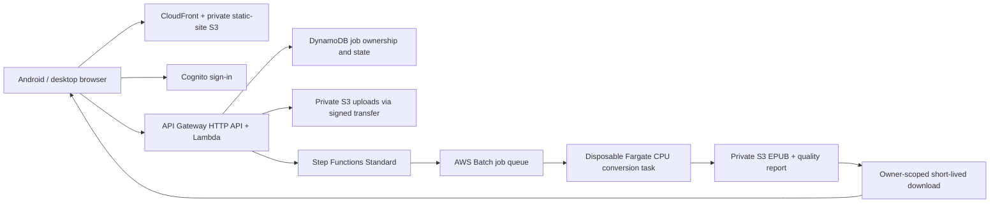

# AWS deployment design

Status: proposed architecture, not a deployed service. The current repository has local conversion prototypes; the multi-user application and infrastructure deployment remain implementation work. No AWS account, region, or spending cap has been selected. `us-east-1` is a planning assumption only.

## Recommended shape

Batch already supplies a job queue; an extra SQS queue is unnecessary for this initial design. Use Step Functions' Batch integration to wait for completion, handle retries and update terminal states. Keep workflow payloads to IDs and object references, not book text. This is an architectural choice, not a claim that the integration is already built here.

## Resource responsibilities

| Service | Role | Initial cost/complexity control |
|---|---|---|
| S3 + CloudFront | Static upload/status application | Private bucket origin, HTTPS, no application server running all day |
| Cognito | Accounts and login | Start with a closed pilot; confirm service availability in the chosen account plan |
| HTTP API + small Lambda handlers | Create job, authorize upload, submit, poll, download, delete | File bytes go directly to S3; keep OCR outside request handlers |
| DynamoDB on-demand | Job ID, authenticated owner, status, input/output keys, expiry | Owner checks on every read/write; TTL is cleanup assistance, not immediate deletion |
| Private S3 buckets/prefixes | Quarantined input, intermediate artifacts, validated output | Encryption, public-access block, lifecycle cleanup, explicit delete workflow |
| Step Functions Standard | Durable orchestration and cancellation/retry handling | No full-text workflow state; idempotent stages |
| AWS Batch on Fargate | Isolated CPU conversion jobs using an ECR image | No idle worker service; low maximum vCPU capacity, bounded attempts and explicit job timeout |
| ECR + CloudWatch | Worker images and operational logs | Image lifecycle, short log retention, no document text or signed URLs in logs |

GPU inference would need a separate supported compute path, such as Batch on EC2 GPU instances. Do not assume Fargate supplies GPUs. Benchmark CPU Docling/Tesseract before adding GPU models or paid external AI APIs.

## API contract to implement

- `POST /jobs`: authenticated; allowlisted file type, expected bytes, language, preset and metadata. Return a job ID and short-lived constrained S3 upload instructions.
- `POST /jobs/{id}/submit`: verify ownership, object existence, actual size and file signature; atomically transition from uploading and start one workflow. Retries must not create duplicate conversions. Freeze/version the accepted input so a reused upload URL cannot replace it during processing.
- `GET /jobs/{id}`: return owner-visible state and actual stage, warnings and expiry. Never expose another user's job by guessing its ID.
- `GET /jobs/{id}/download`: recheck ownership and validation, then issue a short-lived signed EPUB URL. Set a safe attachment filename and correct MIME type.
- `POST /jobs/{id}/cancel`: stop future work and request termination of active compute; report races honestly.
- `DELETE /jobs/{id}`: stop work and remove owned input, intermediate and output objects; prevent late-running workers from recreating deleted artifacts. Lifecycle rules are a backstop, not a promise of immediate deletion.

Use an explicit state machine: uploading -> inspecting -> queued -> converting -> validating -> ready/needs_review/failed, plus cancelling/cancelled/deleting/deleted. Idempotency keys and a source-hash+pipeline-version manifest make reruns traceable without sharing private user files across accounts.

## Worker boundaries

Each job gets a disposable working directory and isolated compute. Validate signatures and archive expansion limits, reject encrypted/macro-enabled input in the initial service, and bound CPU, memory, output size and runtime. Legacy DOC normalization uses a separate LibreOffice profile. No user-supplied command-line flags, shell snippets, filters or arbitrary URLs.

Run untrusted conversion without account-wide storage credentials or general internet access. Design the controller/worker handoff with per-job object access and a restricted network path; confirm that the selected container/network arrangement actually enforces this before public upload. Do not call a Python subprocess or Pandoc `--sandbox` alone a complete isolation boundary. Pandoc's own manual recommends sanitization and timeouts for untrusted content.

Preload approved OCR/layout models into the worker image or a controlled cache. Otherwise first-job downloads can dominate runtime and require internet access. Pin tool/model/image revisions and keep their licenses and notices with the build.

## Upload privacy and retention

Proposed pilot defaults, to confirm before launch: input/intermediates retained for 24 hours; finished files for seven days; signed transfer links expire after minutes. Tell users the actual policy before upload. Log operational IDs and error classes, not content or credentials. Separate delete-now behavior from asynchronous S3 lifecycle cleanup. Existing owned Drive originals are outside these service retention rules and must remain untouched.

## Cost model

The engines can be free/open-source; AWS hosting is usage-billed. Use a low-concurrency private pilot, not unlimited anonymous uploads.

For orientation only, the [AWS Fargate pricing example](https://aws.amazon.com/fargate/pricing/) lists Linux/x86 US East (N. Virginia) CPU at $0.000011244/vCPU-second and memory at $0.000001235/GiB-second. At those example rates, a hypothetical 4-vCPU, 8-GiB job billed for 600 seconds costs:

`600 * (4 * 0.000011244 + 8 * 0.000001235) = $0.0329136` for compute and memory alone.

This is not a measured book runtime or total hosting quote. 100 such runs would be about $3.29 for that compute component; 1,000 about $32.91. Image pulls are billed time. Retries, storage, requests, downloads, logs, orchestration, authentication, networking, public IPv4, extra ephemeral storage and taxes can add cost. Price the actual region and account plan before deployment.

Avoid introducing a permanent load balancer, NAT gateway, database server, or idle OCR service by default. A private network can itself require paid endpoints/NAT, so compare the full networking design rather than claiming scale-to-zero workers mean a zero idle bill. Use upload quotas, page/byte limits, capped concurrent compute, timeouts, alerts, and manual pilot access. Budget alerts are not a hard spending cap. New AWS project spend limits are a separate feature whose eligibility and behavior must be checked.

## Rollout and proof

1. Confirm account sign-in, supported services, region, budget and authentication approach; no deployment as root.
2. Complete the format benchmark and build the worker image; retain the bill of materials, models, license notices and representative fixtures.
3. Implement and test the upload API, static UI, job workflow and infrastructure as code. Preview the concrete change set and costs before provisioning.
4. Deploy a private staging environment. Test a small permissioned DOCX, digital PDF and Telugu scanned PDF through upload -> signed download.
5. Verify cross-user denial, file limits, failures, retry/cancel/delete behavior, object retention, resource cleanup and billing visibility.
6. Run EPUBCheck and physical Android reading tests. Only then enable a limited public launch.

The current local experiment is not a substitute for these deployment tests.

## Primary references

- [Batch Fargate compute environments](https://docs.aws.amazon.com/batch/latest/userguide/fargate.html).
- [Batch job timeouts](https://docs.aws.amazon.com/batch/latest/userguide/job_timeouts.html): configure explicitly; there is no default timeout.
- [Step Functions Batch integration](https://docs.aws.amazon.com/step-functions/latest/dg/connect-batch.html).
- [S3 signed uploads](https://docs.aws.amazon.com/AmazonS3/latest/userguide/PresignedUrlUploadObject.html) and [lifecycle expiration](https://docs.aws.amazon.com/AmazonS3/latest/userguide/lifecycle-expire-general-considerations.html).
- [Lambda timeouts](https://docs.aws.amazon.com/lambda/latest/dg/configuration-timeout.html): ordinary Lambda functions have a 15-minute maximum, which is one reason long conversion work belongs in a job worker.
- [Textract language support](https://docs.aws.amazon.com/textract/latest/dg/supported-languages.html): the current table does not list Telugu; do not choose it as the Telugu OCR default merely because deployment uses AWS.
